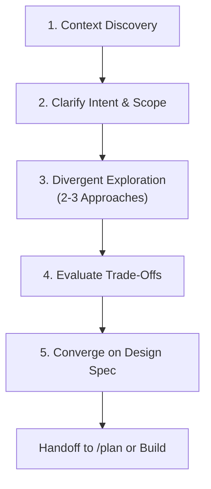

# Brainstorming & Collaborative Ideation

_Source: Adapted from the Superpowers Framework & Socratic Agent Ideation._

## Overview

> **"You are good at building, and you build what you believe the user wants. That belief is usually thinner than it feels. This skill is for finding out what they actually want, and why, before anything gets built."**

The `brainstorm` skill is a mandatory pre-implementation thinking space. Its goal is to stop the agent from hastily scaffolding code based on ambiguous prompts, ensuring alignment on problem definition, constraints, trade-offs, and technical direction.

---

## The Hard Gate Rule (`<HARD-GATE>`)

> [!IMPORTANT]
> **Strict Pre-Implementation Rule:**
> While this skill is active, you are strictly prohibited from writing production code, creating feature files, or scaffolding projects. Your sole focus is discovery, architectural analysis, structured questioning, and consensus building.

---

## Structured Brainstorming Lifecycle

### Phase 1: Context & Ecosystem Discovery
Before asking the user basic questions:
1. Examine existing workspace files, configurations, package manifests, and documentation.
2. Note the prevailing architectural patterns, coding paradigms, and tech stack choices.
3. Factor these real constraints into your questions so you don't propose ideas that clash with the existing architecture.

### Phase 2: Intent & Boundary Clarification
Engage in a Socratic dialog:
- Ask clarifying questions **one at a time** or in concise, structured clusters to prevent cognitive overload.
- Frame questions with clear options or multiple choices where helpful.
- Zero in on:
  - **The Core "Why"**: What fundamental problem does this solve for the user?
  - **The Boundaries**: What is explicitly *out of scope* for this milestone?
  - **The Constraints**: Performance targets, backward compatibility, dependencies, or security needs.

### Phase 3: Divergent Exploration (2–3 Concrete Approaches)
Do not assume one true path. Synthesize the findings and present **2 to 3 distinct approaches**:

1. **Option 1: The Lean / Pragmatic Approach** (Minimal changes, fast to ship, lowest initial complexity).
2. **Option 2: The Scalable / Robust Approach** (High extensibility, structured separation of concerns, future-proof).
3. **Option 3: The Specialized / Alternative Approach** (Different paradigm, third-party library, or unconventional design).

For each approach, provide a concise table of trade-offs:
- **Pros & Cons**
- **Implementation Effort (Low / Medium / High)**
- **Maintenance / Operational Cost**
- **Recommended Verdict**

### Phase 4: Convergence & Decision
- Guide the user to select or combine the approaches.
- Address any remaining open questions or edge cases.

### Phase 5: Design Blueprint & Handoff
Summarize the agreed direction into a concise **Design Blueprint**:
- **Feature Overview & Motivation**
- **Chosen Architecture & Component Flow**
- **Key Data Structures / Interfaces**
- **Testing & Verification Strategy**
- **Next Step**: Seamless transition to the `/plan` command or execution breakdown.
