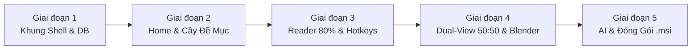

# KẾ HOẠCH THỰC THI KỸ THUẬT CHI TIẾT
# (TECHNICAL IMPLEMENTATION PLAN)
## DỰ ÁN: BLENDERFLOW DESKTOP

---

## 1. TỔNG QUAN KẾ HOẠCH (PLAN OVERVIEW)

Tài liệu này xác định lộ trình thực thi kỹ thuật chi tiết theo từng bước (Step-by-Step Execution Plan) để chuyển giao từ bản đặc tả [BLENDERFLOW_SOFTWARE_SPEC.md](file:///c:/Users/Admin/Desktop/CODE/BLENDERFLOW_SOFTWARE_SPEC.md) và mẫu giao diện [stitch_3d_practice_mode.html](file:///c:/Users/Admin/Desktop/CODE/stitch_3d_practice_mode.html) thành phần mềm Desktop hoàn chỉnh, có thể chạy độc lập trên Windows.

---

## 2. CẤU TRÚC THƯ MỤC DỰ ÁN DỰ KIẾN (PROJECT STRUCTURE)

```text
blenderflow-desktop/
├── src-tauri/                     # Tầng Native Host (Rust + Tauri v2)
│   ├── Cargo.toml                 # Rust dependencies (tauri, tauri-plugin-sql, tauri-plugin-shell)
│   ├── tauri.conf.json            # Cấu hình cửa sổ, quyền truy cập native, bundle config
│   ├── icons/                     # Icon ứng dụng (.ico, .png cho Windows)
│   └── src/
│       ├── main.rs                # Điểm khởi chạy ứng dụng Tauri
│       ├── lib.rs                 # Quản lý Tauri plugins & invoke commands
│       ├── blender_bridge.rs      # Rust commands gọi blender.exe & quản lý Named Pipe IPC
│       └── window_manager.rs      # Lệnh điều khiển thu nhỏ/phóng to/đóng cửa sổ & Auto-Snap 50:50
│
├── src/                           # Tầng Giao Diện Người Dùng (React 18/19 + TypeScript)
│   ├── index.html                 # Entry point HTML
│   ├── main.tsx                   # Entry point React
│   ├── App.tsx                    # Shell Layout chính (Sidebar 220px + Main View Router)
│   │
│   ├── assets/                    # Tài nguyên tĩnh nội bộ
│   │   ├── models/                # Mô hình 3D mẫu (.gltf / .obj: chair, table, sword, cup)
│   │   ├── blend_starters/        # File bài tập mẫu (.blend đính kèm)
│   │   └── addons/                # File blenderflow_addon.py cài vào Blender
│   │
│   ├── components/                # Thư viện UI Components dùng chung
│   │   ├── layout/
│   │   │   ├── NavigatorSidebar.tsx   # Cột trái 220px (Logo, Nav items, Streak, Bridge status)
│   │   │   └── DesktopTitlebar.tsx    # Thanh điều khiển cửa sổ (Drag region, ⌘K, — □ ✕)
│   │   ├── common/
│   │   │   ├── KeycapBadge.tsx        # Component hiển thị phím tắt dạng <kbd> (Ctrl+B, Shift+A)
│   │   │   ├── ProgressBar.tsx        # Thanh tiến độ tuyến tính & chỉ số hoàn thành
│   │   │   └── Modal.tsx              # Hộp thoại tạo lộ trình mới & Settings
│   │   ├── 3d/
│   │   │   ├── ModelInspector3D.tsx   # Three.js 360° Canvas (Orbit, Grid floor, 3-point light)
│   │   │   ├── ViewportToolstrip.tsx  # Bộ nút Wireframe / Solid / X-Ray & Numpad views (1, 7, 3)
│   │   │   └── MetricsHUD.tsx         # Bảng HUD hiển thị Vertices / Faces / Modifiers
│   │   └── practice/
│   │       ├── TaskChecklist.tsx      # Bảng checklist nhiệm vụ từng bước
│   │       ├── BlenderLauncherBar.tsx # Nút 1-click mở file .blend trong Blender
│   │       └── AddonSyncWidget.tsx    # Widget đồng bộ và nút Verify Topology
│   │
│   ├── views/                     # Các màn hình phân hệ chính
│   │   ├── HomeDashboardView.tsx      # Màn hình Home (Resume Card + Lưới khóa học)
│   │   ├── CourseWorkspaceView.tsx    # Không gian khóa học (Modules + Practice blocks)
│   │   ├── SlideOverReader.tsx        # Trình đọc bài học 3D 80% (Markdown + GIF + Hotkey drill)
│   │   ├── SplitPracticeView.tsx      # Chế độ thực hành kép 50:50 (Inspector + Live Blender)
│   │   ├── HotkeyCheatsheetView.tsx   # Bảng tra cứu phím tắt theo Mode (Edit/Object/Sculpt)
│   │   └── SettingsModal.tsx          # Cài đặt đường dẫn blender.exe & API Key AI
│   │
│   ├── services/                  # Tầng xử lý logic & dữ liệu
│   │   ├── db.ts                  # SQLite Service (Khởi tạo bảng, CRUD khóa học, tiến độ)
│   │   ├── blenderService.ts      # Gọi lệnh native mở file .blend & kiểm tra kết nối IPC
│   │   └── aiService.ts           # Hybrid AI Adapter (Google Gemini Flash & Local Ollama)
│   │
│   ├── hooks/                     # Custom React Hooks
│   │   ├── useRoadmap.ts          # Quản lý state khóa học và cập nhật % tiến độ
│   │   ├── useThreeViewer.ts      # Khởi tạo và quản lý Scene Three.js
│   │   └── useKeyboardShortcut.ts # Lắng nghe phím tắt toàn cục (Esc, Ctrl+K, Ctrl+H)
│   │
│   └── types/                     # TypeScript Interface Definitions
│       ├── roadmap.ts             # Course, Module, Lesson, PracticeTask
│       ├── model.ts               # ModelSpec, ShadingMode, CameraView
│       └── hotkey.ts              # HotkeyItem, BlenderMode
│
└── package.json                   # Dependencies quản lý bằng pnpm/npm
```

---

## 3. DANH MỤC PACKAGES CẦN CÀI ĐẶT (DEPENDENCIES MANIFEST)

### 3.1. Rust Crate Dependencies (`src-tauri/Cargo.toml`)
- `tauri = { version = "2.0", features = ["tray-icon"] }`
- `tauri-plugin-sql = { version = "2.0", features = ["sqlite"] }`: Cơ sở dữ liệu SQLite cục bộ.
- `tauri-plugin-shell = "2.0"`: Khởi chạy tiến trình `blender.exe`.
- `tauri-plugin-fs = "2.0"`: Đọc/ghi file mô hình và sao lưu dữ liệu.
- `serde = { version = "1.0", features = ["derive"] }` & `serde_json = "1.0"`.
- `tokio = { version = "1.0", features = ["full"] }`: Hỗ trợ giao tiếp socket IPC bất đồng bộ.

### 3.2. Frontend Dependencies (`package.json`)
```json
{
  "dependencies": {
    "react": "^18.3.1",
    "react-dom": "^18.3.1",
    "@tauri-apps/api": "^2.0.0",
    "@tauri-apps/plugin-sql": "^2.0.0",
    "@tauri-apps/plugin-shell": "^2.0.0",
    "three": "^0.168.0",
    "@types/three": "^0.168.0",
    "lucide-react": "^0.453.0",
    "react-markdown": "^9.0.1",
    "remark-gfm": "^4.0.0",
    "clsx": "^2.1.1",
    "tailwind-merge": "^2.5.4"
  },
  "devDependencies": {
    "@types/react": "^18.3.11",
    "@types/react-dom": "^18.3.0",
    "@vitejs/plugin-react": "^4.3.2",
    "autoprefixer": "^10.4.20",
    "postcss": "^8.4.47",
    "tailwindcss": "^3.4.13",
    "typescript": "^5.6.3",
    "vite": "^5.4.8"
  }
}
```

---

## 4. PHÂN KỲ THỰC THI CHI TIẾT (5 IMPLEMENTATION PHASES)



---

### 📍 GIAI ĐOẠN 1: KHỞI TẠO NỀN TẢNG, DESKTOP SHELL & LOCAL DATABASE
- **Mục tiêu**: Thiết lập bộ khung ứng dụng desktop hoàn chỉnh, theme Dark Slate, hệ thống titlebar điều khiển cửa sổ và cơ sở dữ liệu SQLite cục bộ.
- **Các đầu việc cụ thể (Tasks)**:
  1. **Task 1.1**: Khởi tạo dự án `tauri v2` kết hợp `react-ts` và `vite`.
  2. **Task 1.2**: Cấu hình **Tailwind CSS** với hệ màu Dark Slate (`#0B0F19`, `#111827`, `#1F2937`, `#F97316`, `#10B981`, `#6366F1`) và font chữ Plus Jakarta Sans / Space Grotesk.
  3. **Task 1.3**: Xây dựng **Desktop Shell 2 cột**:
     - Cột trái: `NavigatorSidebar.tsx` (cố định 220px, icon 3D cam, các tab điều hướng, widget Streak).
     - Khung trên: `DesktopTitlebar.tsx` (chiều cao 44px, vùng kéo cửa sổ native, cụm nút `— □ ✕`).
  4. **Task 1.4**: Cấu hình Tauri SQL plugin, tạo file `src/services/db.ts` với câu lệnh khởi tạo bảng SQLite:
     - Bảng `roadmaps`, `modules`, `lessons`, `practice_tasks`, `hotkeys`, `settings`.
     - Nạp dữ liệu mẫu ban đầu (Seed Data) cho khóa học *"Hard-Surface & Low-Poly 3D Modeling"*.
- **Tiêu chuẩn nghiệm thu (DoD)**:
  - Ứng dụng Desktop mở lên trong <1.2s, kéo di chuyển cửa sổ mượt mà, bấm `— □ ✕` điều khiển được cửa sổ.
  - Dữ liệu khóa học mẫu hiển thị thành công từ database SQLite.

---

### 📍 GIAI ĐOẠN 2: MÀN HÌNH HOME DASHBOARD & CÂY ĐỀ MỤC KHÓA HỌC
- **Mục tiêu**: Hoàn thiện không gian quản lý tiến độ học tập trực quan, ít chữ thừa, hiển thị thanh tiến độ chuẩn xác.
- **Các đầu việc cụ thể (Tasks)**:
  1. **Task 2.1**: Xây dựng `HomeDashboardView.tsx`:
     - Thẻ Hero **Resume Learning** (hiển thị bài học dở dang, hotkeys focus, thanh progress bar 64%, nút `Resume Lesson →`).
     - Lưới **My Roadmaps Grid** (3 cột tối giản, filter tabs *All / In Progress / Completed*, thanh tiến độ % phẳng).
  2. **Task 2.2**: Xây dựng `CourseWorkspaceView.tsx`:
     - Header khóa học, Breadcrumb, thanh tiến độ tổng quan lớn.
     - Cây danh sách các Module dạng Accordion:
       - *Module 1 (Hoàn thành 100%)*: Thu gọn, badge Mastered.
       - *Module 2 (Đang học 60%)*: Danh sách bài học con + nhãn `ACTIVE`.
       - *Module 3 (Khóa 0%)*: Biểu tượng ổ khóa.
  3. **Task 2.3**: Xây dựng Khối Bài Tập Dưới Module (`PracticeBlock.tsx`):
     - Đặt cố định ngay dưới danh sách bài học của Module.
     - 3 thẻ tương tác: *Hotkey Speed Drill*, *3D Challenge*, *Open Starter .blend*.
- **Tiêu chuẩn nghiệm thu (DoD)**:
  - Người dùng bấm lọc khóa học mượt mà; bấm vào khóa học chuyển vào đúng không gian khóa học với cây đề mục và khối bài tập rõ ràng.

---

### 📍 GIAI ĐOẠN 3: TRÌNH ĐỌC BÀI HỌC 3D (FOCUS READER 80%) & HỆ THỐNG PHÍM TẮT
- **Mục tiêu**: Xây dựng không gian đọc bài học tập trung cao độ, trực quan hóa các phím tắt bàn phím và bảng tra cứu phím tắt.
- **Các đầu việc cụ thể (Tasks)**:
  1. **Task 3.1**: Xây dựng `SlideOverReader.tsx`:
     - Khung Drawer trượt từ mép phải chiếm 80% chiều rộng màn hình.
     - Nền phía sau làm mờ nhẹ (backdrop blur), bấm ra ngoài hoặc ấn `Esc` để đóng.
     - Nút Fullscreen 100% mở rộng toàn màn hình.
     - Nút chỉnh cỡ chữ `Aa` (Standard / Comfortable / Compact).
  2. **Task 3.2**: Xây dựng component `KeycapBadge.tsx` (`<kbd>`) hiển thị phím bấm bàn phím nổi bật.
  3. **Task 3.3**: Tích hợp trình đọc Markdown (`react-markdown`) hỗ trợ định dạng bài giảng 3D, bảng so sánh 2 cột, và khu vực ghi chú học viên tự động lưu (`Auto-saved`).
  4. **Task 3.4**: Xây dựng màn hình tra cứu phím tắt `HotkeyCheatsheetView.tsx`:
     - Phân loại theo *Object Mode*, *Edit Mode*, *Sculpt Mode*, *Shader Editor*.
     - Ô tìm kiếm tức thì theo tên công cụ (Bevel, Inset, Loop cut,...).
- **Tiêu chuẩn nghiệm thu (DoD)**:
  - Bấm vào bài học mở Focus Reader 80% mượt mà; phím tắt `<kbd>` hiển thị sắc nét; tra cứu phím tắt phản hồi ngay khi gõ từ khóa.

---

### 📍 GIAI ĐOẠN 4: CHẾ ĐỘ THỰC HÀNH 3D KÉP (DUAL-VIEW 50:50) & KẾT NỐI BLENDER
- **Mục tiêu**: Hiện thực hóa tính năng cốt lõi: Vừa soi mô hình 3D mẫu xoay 360 độ (Three.js), vừa kết nối mở Blender native và theo dõi checklist.
- **Các đầu việc cụ thể (Tasks)**:
  1. **Task 4.1**: Xây dựng `ModelInspector3D.tsx` (Three.js WebGL Engine):
     - Khởi tạo Scene, PerspectiveCamera, WebGLRenderer khử răng cưa.
     - Thiết lập hệ thống 3 đèn studio và sàn lưới (Grid Floor).
     - Thuật toán dựng hình chiếc ghế Low-poly chuẩn (Seat base, 4 angled legs, backrest, wireframe quad overlay).
     - Orbit Controls cho phép click giữ chuột xoay 360°, cuộn chuột zoom.
  2. **Task 4.2**: Xây dựng `ViewportToolstrip.tsx` & `MetricsHUD.tsx`:
     - Nút chuyển chế độ Shading: **Wireframe**, **Solid**, **X-Ray**.
     - Nút chuyển góc nhìn chuẩn Numpad Blender: **Front (`1`)**, **Top (`7`)**, **Right (`3`)**.
     - Bảng HUD đo đạc: `148 Vertices`, `136 Faces (100% Quads)`, `Modifiers: Mirror + Bevel`.
  3. **Task 4.3**: Xây dựng `BlenderLauncherBar.tsx`:
     - Viết Rust command `open_blend_file(file_path: String)` trong `src-tauri`.
     - Tự động nhận diện đường dẫn cài đặt của Blender (`blender.exe`) trên Windows.
     - Khi bấm nút cam: Khởi chạy Blender và nạp sẵn file bài tập tương ứng.
  4. **Task 4.4**: Xây dựng `TaskChecklist.tsx` & Widget Đồng Bộ:
     - 4 bước thực hành có ô tích hoàn thành.
     - Viết file Python addon `blenderflow_addon.py` cài vào Blender để đọc số đỉnh/mặt của vật thể đang chọn và gửi về ứng dụng qua Local IPC Socket.
     - Nút "Verify Topology" kiểm tra đối chiếu và nút "Submit Challenge" cập nhật tiến độ.
- **Tiêu chuẩn nghiệm thu (DoD)**:
  - Khung 3D Three.js xoay mượt mà, chuyển đổi Wireframe / Solid tức thì; bấm nút cam mở đúng phần mềm Blender; checklist ghi nhận đúng tiến độ bài học.

---

### 📍 GIAI ĐOẠN 5: TÍCH HỢP TRỢ LÝ AI 3D, SAO LƯU & ĐÓNG GÓI WINDOWS INSTALLER
- **Mục tiêu**: Hoàn thiện tính năng AI trợ lý, sao lưu dữ liệu và đóng gói phần mềm thành bộ cài đặt `.msi` / `.exe` độc lập.
- **Các đầu việc cụ thể (Tasks)**:
  1. **Task 5.1**: Xây dựng `aiService.ts`:
     - Cấu hình API Key Google Gemini (gói Flash miễn phí) hoặc URL kết nối Local Ollama.
     - Tính năng "AI Trợ lý 3D": Giải thích lỗi lật mặt lưới (Normals), lỗi dính điểm, gợi ý phím tắt.
     - Tính năng "Tạo Lộ Trình 3D Bằng AI": Nhập chủ đề $\rightarrow$ AI sinh khung các Module chuẩn JSON.
  2. **Task 5.2**: Xây dựng tính năng Export / Import:
     - Xuất toàn bộ tiến độ và ghi chú ra file `.json`.
     - Nhập lại file khóa học khi chuyển sang máy tính mới.
  3. **Task 5.3**: Tối ưu hóa hiệu năng & Kiểm thử:
     - Kiểm tra ngắt mạng hoàn toàn (Offline Mode Test).
     - Kiểm tra mức tiêu thụ RAM khi chạy song song với Blender (phải $\le 25$MB).
  4. **Task 5.4**: Đóng gói bộ cài đặt:
     - Chạy lệnh `pnpm tauri build`.
     - Xuất file cài đặt Windows Installer (`.msi` / `.exe` x64).
- **Tiêu chuẩn nghiệm thu (DoD)**:
  - Có file cài đặt `.msi` dung lượng <15MB, cài đặt 1-click trên máy tính Windows sạch là chạy ngay, ngắt mạng vẫn sử dụng 100% tính năng cốt lõi.

---

## 5. MA TRẬN PHỤ THUỘC & THỨ TỰ THỰC HIỆN (EXECUTION MATRIX)

```text
[Phase 1: Tauri + React + SQLite Scaffold]
       │
       ▼
[Phase 2: Home Dashboard & Course Workspace]
       │
       ▼
[Phase 3: Focus Reader 80% & Hotkey Engine]
       │
       ▼
[Phase 4: Dual-View 50:50 Three.js & Blender Bridge]  <-- Cốt lõi khác biệt
       │
       ▼
[Phase 5: AI Integration & Windows Packaging]
```

---

> [!NOTE]
> Kế hoạch thực thi này đã sẵn sàng. Toàn bộ các bước đều độc lập, rõ ràng và có thể bắt đầu tiến hành tuần tự từ **Giai đoạn 1** ngay lập tức.
