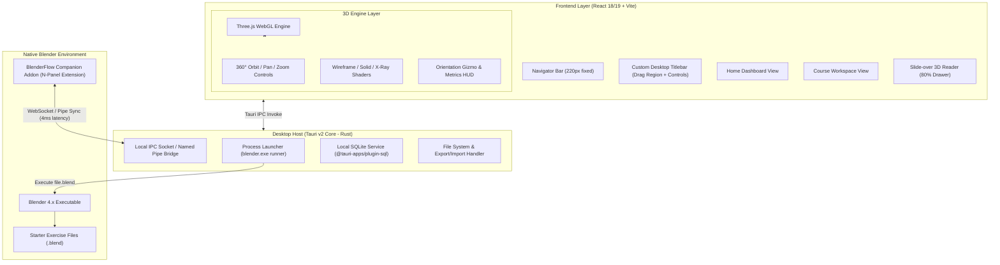
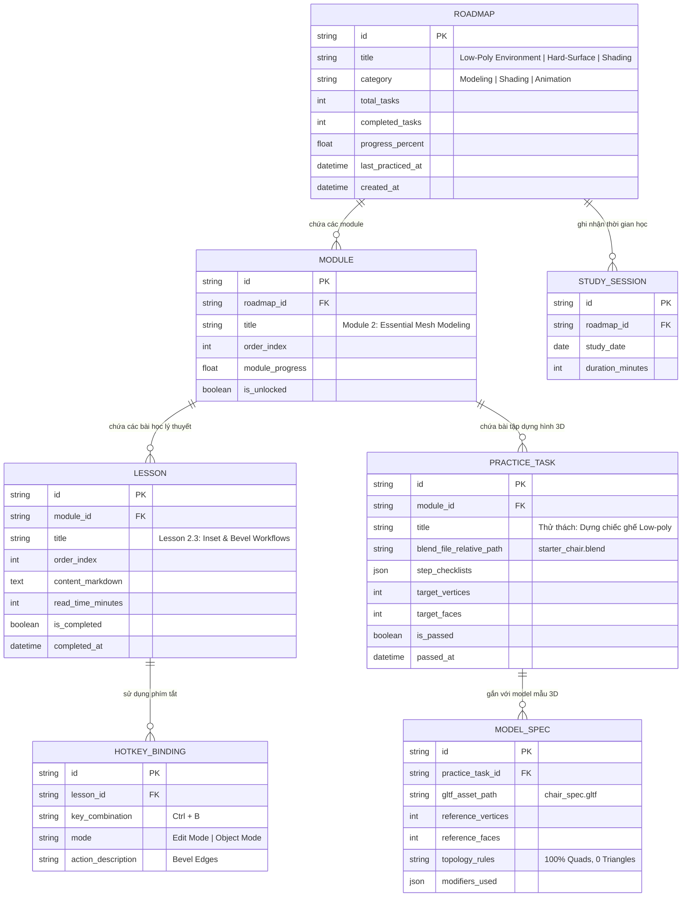
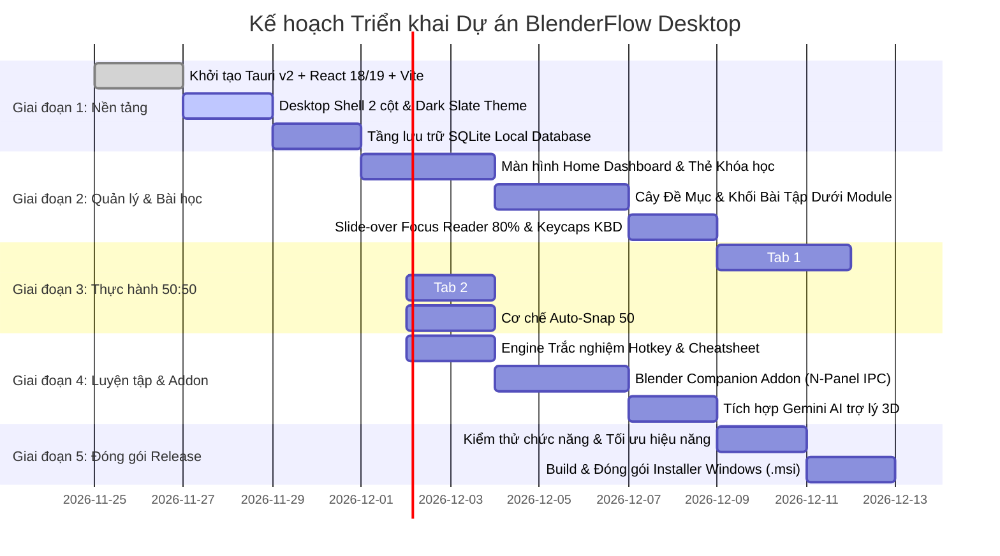

# TÀI LIỆU ĐẶC TẢ KỸ THUẬT & KIẾN TRÚC PHẦN MỀM
# (SOFTWARE REQUIREMENTS & ARCHITECTURE SPECIFICATION - SRS)
## DỰ ÁN: BLENDERFLOW DESKTOP
### Ứng Dụng Tự Học 3D Blender, Soi Mẫu Tương Tác 360° & Thực Hành Kép (Dual-View 50:50)

---

## 1. TỔNG QUAN HỆ THỐNG (SYSTEM OVERVIEW)

### 1.1. Tuyên bố sứ mệnh (Mission Statement)
**BlenderFlow Desktop** là ứng dụng máy tính cá nhân (Desktop App) được thiết kế chuyên biệt để giúp người học làm chủ phần mềm đồ họa 3D **Blender** một cách có hệ thống, trực quan và đạt hiệu quả thực chiến cao nhất. 

Ứng dụng giải quyết triệt để rào cản lớn nhất của người mới học 3D: **vừa phải nhớ hàng trăm phím tắt phức tạp, vừa phải liên tục chuyển đổi qua lại giữa cửa sổ hướng dẫn và phần mềm Blender thật**.

### 1.2. Các trụ cột giá trị cốt lõi (Core Pillars)
1. **Dual-View Practice (Thực hành kép 50:50)**:
   - Nửa màn hình bên trái là **3D Model Inspector 360°** chạy WebGL siêu nhẹ để soi đường lưới (Topology/Wireframe), góc cạnh và thông số chuẩn.
   - Nửa màn hình bên phải là phần mềm **Blender native** mở sẵn file bài tập `.blend` để người học thỏa sức dùng toàn bộ phím tắt và công cụ native.
2. **Hotkey-First & Visual Action**:
   - Tối giản chữ nghĩa rườm rà; tập trung toàn bộ vào dải phím tắt tương tác (`<kbd>G</kbd>`, `<kbd>R</kbd>`, `<kbd>S</kbd>`, `<kbd>Tab</kbd>`, `<kbd>Ctrl+B</kbd>`), bảng tra cứu phím tắt (Cheatsheet) và ảnh minh họa thao tác.
3. **Local-First & Siêu tiết kiệm tài nguyên**:
   - Xây dựng trên nền tảng **Tauri v2 + Rust**, chiếm dưới **25MB RAM** khi chạy nền.
   - Toàn bộ tiến độ học, ghi chú cá nhân và bài tập lưu trữ 100% trong cơ sở dữ liệu **SQLite** cục bộ trên máy tính người dùng.

---

## 2. KIẾN TRÚC KỸ THUẬT & TECH STACK (TECHNICAL ARCHITECTURE)



### 2.1. Chi tiết Tech Stack

| Tầng hệ thống | Công nghệ lựa chọn | Lý do lựa chọn & Vai trò |
|---|---|---|
| **Desktop Shell** | **Tauri v2 (Rust)** | Khởi động tức thì (<0.5s), file cài đặt siêu nhỏ (<15MB), ngốn RAM cực thấp (<25MB), gọi tiến trình `blender.exe` an toàn. |
| **Frontend Framework** | **React (TypeScript) + Vite** | Hệ sinh thái mạnh, type-safe tuyệt đối, hot-reload siêu tốc. |
| **Styling & Theme** | **Tailwind CSS (Dark Slate Theme)** | Nền `#0B0F19`, thẻ `#111827`, điểm nhấn **Blender Orange (`#F97316`)** và **Emerald (`#10B981`)**. |
| **3D Rendering Engine** | **Three.js (WebGL)** | Render trực tiếp mô hình mẫu 3D trong App, hỗ trợ Wireframe quad lines, xoay 360° không tốn GPU. |
| **Cơ sở dữ liệu cục bộ** | **SQLite (Local-First)** | Lưu trữ tiến độ, lộ trình, kết quả bài tập trực tiếp tại ổ cứng người dùng. |
| **Giao tiếp với Blender** | **Rust Named Pipes / WebSockets + Python Addon** | Đồng bộ hóa thời gian thực (4ms latency) giữa phiên Blender đang mở và App. |
| **Hỗ trợ AI (Hybrid)** | **Google Gemini 2.0 Flash + Local Ollama** | Sinh lộ trình học theo yêu cầu, giải đáp lỗi 3D, phân tích topology. |

---

## 3. CẤU TRÚC DỮ LIỆU CỐT LÕI (DATABASE SCHEMA)



---

## 4. ĐẶC TẢ CHI TIẾT CÁC PHÂN HỆ GIAO DIỆN & TÍNH NĂNG (FEATURE SPECS)

---

### 4.1. Màn Hình Home Dashboard (Trung Tâm Điều Khiển)
- **Bố cục 2 phần dọc**:
  - **Navigator Bar Trái (Width 220px)**:
    - Logo BlenderFlow (icon xoắn ốc 3D màu cam).
    - Menu: `Home`, `Search (⌘K)`, `My Roadmaps`, `Hotkey Cheatsheet`, `Settings`.
    - Widget chân trang: Chuỗi ngày học liên tục (`🔥 12d`) và trạng thái cầu nối (`🟢 Blender 4.2 Bridge Connected`).
  - **Khung chính (Right Area)**:
    - Custom Desktop Titlebar (Height 48px): Vùng kéo thả cửa sổ (`data-tauri-drag-region`), ô tìm kiếm nhanh `⌘K Search...`, nút `+ New Roadmap` (hỗ trợ tạo Manual hoặc AI Generate), nút Window Controls (`— □ ✕`).
- **Thẻ Hero "Resume Learning" (Vị trí ưu tiên số 1)**:
  - Hiển thị bài học 3D gần nhất đang dang dở.
  - Tiêu đề khóa học: *"Hard-Surface & Low-Poly 3D Modeling"*.
  - Bài học tiếp theo: *"Lesson 2.3: Inset & Bevel Workflows"*.
  - Dải phím tắt trọng tâm: `<kbd>I</kbd> Inset Faces` • `<kbd>Ctrl+B</kbd> Bevel Edges`.
  - Thanh tiến độ tuyến tính 64% (16/25 bài hoàn thành).
  - Nút hành động trực tiếp màu cam Blender: **"Resume Lesson →"**.
- **Lưới Khóa Học "My Roadmaps"**:
  - Lưới 3 cột tinh gọn, loại bỏ chữ thừa.
  - Thẻ khóa học hiển thị: Tag danh mục, tiêu đề 1 dòng, thanh tiến độ % phẳng, thông số (`16/25 lessons • 5 drills`) và link `Resume →`.

---

### 4.2. Không Gian Lộ Trình Khóa Học (Course Study Workspace)
- **Header Khóa Học**:
  - Breadcrumb: `Home > Hard-Surface & Low-Poly 3D Modeling`.
  - Tiêu đề khóa học kèm nút "Edit Roadmap".
  - **Thanh tiến độ tổng quan lớn**: Thể hiện tỷ lệ % hoàn thành toàn khóa kèm thống kê (`16/25 Lessons Finished • 5 Hotkey Drills Passed • ~4h left`).
  - Nút CTA nhanh: **"Continue: Lesson 2.3 (Bevel Workflows) →"**.
- **Các Module Được Chia Khối Rõ Ràng (Section Cards)**:
  - **Module 1 (Đã hoàn thành 100%)**: Thu gọn gọn gàng, tick xanh, hiển thị điểm thi đạt `10/10 Mastered`.
  - **Module 2 (Đang học - 60%)**:
    - Danh sách bài học dạng hàng: Checkbox trạng thái, tiêu đề bài, thời lượng đọc, dải phím tắt gợi ý.
    - Bài 2.3 có nhãn `ACTIVE` nổi bật kèm nút `Open Lesson →`.
    - **Khối Bài Tập Thực Hành Đặt Ngay Dưới Module 2 (Practice Block)**:
      - Nằm cố định ngay dưới danh sách bài học của Module 2.
      - Gồm 3 thẻ hành động trực quan:
        1. ⚡ **Hotkey Speed Drill**: Trắc nghiệm 10 câu về phím tắt Edit Mode $\rightarrow$ [Start Quiz].
        2. 🪑 **3D Challenge: Dựng chiếc ghế Low-poly**: Nhiệm vụ tạo hình có checklist $\rightarrow$ [Start Practice Mode].
        3. 📁 **File Khởi Đầu**: Tải file `starter_chair.blend` $\rightarrow$ [Open in Blender ↗].
  - **Module 3 (Khóa - 0%)**: Hiển thị icon ổ khóa mờ kèm tên module.

---

### 4.3. Khung Đọc Bài Học 3D (Slide-over Focus Reader 80%)
- Trượt ra từ mép phải màn hình chiếm **80% chiều rộng**, làm mờ nhẹ nền không gian học phía sau.
- Có nút chuyển đổi **Fullscreen 100%** toàn màn hình khi cần tập trung đọc sâu.
- **Top Bar (Height 44px)**: Breadcrumb bài học, nút chỉnh cỡ chữ (`Aa` 100%, 115%, 90%), nút Fullscreen và phím tắt `[Esc]` để đóng.
- **Nội dung bài học chuẩn hóa cho 3D**:
  - **Dải Phím Tắt Trọng Tâm (Interactive Keycap Strip)**: Hiển thị các khối phím nổi bật dạng bàn phím:
    `<kbd>I</kbd> Inset Faces` • `<kbd>Ctrl + B</kbd> Bevel Edges` • `<kbd>Scroll Wheel</kbd> Số phân đoạn Bevel`.
  - **Hướng dẫn thao tác từng bước 1-2-3**: Trực quan, súc tích kèm ảnh minh họa hoặc ảnh GIF thao tác chuột.
  - **So sánh 2 cột trực quan**: Định nghĩa công cụ và sự khác biệt (ví dụ: Vertex Bevel `<kbd>Ctrl+Shift+B</kbd>` vs Edge Bevel `<kbd>Ctrl+B</kbd>`).
  - **Ghi chú cá nhân của học viên (Markdown Notebook)**: Tự động lưu cục bộ (`Auto-saved`).
- **Khối Luyện Phím Tắt (Hotkey Quick Drill)**:
  - 1-3 câu hỏi trắc nghiệm phản xạ ngay dưới bài đọc.
  - Bấm chọn phương án $\rightarrow$ Đổi màu xanh lá / đỏ tức thì kèm giải thích chi tiết.
- **Sticky Bottom Bar (Height 56px)**: Nút `Prev Lesson`, nút **"Mark Lesson Completed ✓"** và nút `Next Lesson`.

---

### 4.4. Tính Năng Độc Quyền: Chế Độ Thực Hành 3D Chia Đôi Màn Hình (Dual-View 50:50)

Khi học viên bấm nút **"Bắt đầu Thử thách Dựng hình 3D"**:
Cửa sổ chuyển sang chế độ **Split Practice Mode (50:50)**:

```
+---------------------------------------------------------------------------------------+
|  BLENDERFLOW DESKTOP                                                      —  □  ✕     |
+-------------------------------------------+-------------------------------------------+
|  TAB 1: 3D MODEL INSPECTOR (MẪU 360°)     |  TAB 2: THỰC HÀNH & KẾT NỐI BLENDER       |
|                                           |                                           |
|  [Wireframe] [Solid] [X-Ray] [Views 1,7,3]|  [ 🚀 Open starter_chair.blend in Blender]|
|                                           |                                           |
|       ( 3D WebGL Canvas: Low-poly Chair ) |  TIẾN ĐỘ THỰC HÀNH: 2/4 BƯỚC (50%)        |
|       - Xoay chuột Orbit 360 độ           |  [x] Bước 1: Base Blockout (Shift+A, S+Z) |
|       - Soi từng đường lưới (Edge Loops)  |  [x] Bước 2: Inset & Extrude 4 chân (I, E)|
|       - 100% Mặt Tứ Giác (Quads)          |  [ ] Bước 3: Dựng thành tựa lưng (E)      |
|                                           |  [ ] Bước 4: Bo tròn cạnh bằng Bevel      |
|  THÔNG SỐ MẪU THAM CHIẾU (HUD):           |                                           |
|  • Vertices: 148   • Faces: 136 (Quads)   |  BLENDERFLOW ADDON (IPC CONNECTED):       |
|  • Modifiers: Mirror + Bevel (3s)         |  [ Nút: Verify Topology (Kiểm tra lưới) ] |
|  • Rule: Uniform loops, 0 Tris, 0 N-gons  |  [ Nút: Submit & Complete Challenge ✓ ]   |
+-------------------------------------------+-------------------------------------------+
```

#### Chi tiết Kỹ thuật Tab 1 (Nửa Trái - 3D Model Inspector):
1. **Three.js WebGL Canvas**:
   - Render mô hình chuẩn low-poly với sàn lưới Blender (Grid Floor), hệ thống 3 đèn studio chuyên nghiệp.
   - Cho phép người dùng click giữ chuột để **xoay 360 độ**, cuộn chuột để zoom to/nhỏ.
2. **Toolstrip Chế độ hiển thị Shading**:
   - `Wireframe`: Hiển thị rõ ràng các đường cạnh đa giác (màu tím sáng/indigo trên nền tối) để học viên soi cấu trúc lưới (Topology/Edge Flow).
   - `Solid`: Xem khối đặc với vật liệu clay/wood ấm áp.
   - `X-Ray`: Xem xuyên thấu để nhìn các chi tiết bên trong.
3. **Camera Preset Pills (Phím Numpad Chuẩn Blender)**:
   - Nút `Front` (`Numpad 1`): Chuyển thẳng về góc nhìn chính diện.
   - Nút `Top` (`Numpad 7`): Chuyển về góc nhìn từ trên xuống.
   - Nút `Right` (`Numpad 3`): Chuyển về góc nhìn cạnh bên phải.
4. **Bảng Thông Số Mẫu Tham Chiếu (Metrics HUD)**:
   - Hiển thị chính xác: `Vertices: 148`, `Faces: 136 (100% Quads)`, `Modifiers: Mirror + Bevel (3 segments)`.
   - Khung quy chuẩn Topology (Target Topology Rule): Hướng dẫn học viên giữ vòng cạnh đều, không tạo mặt 3 cạnh (Tris) hoặc mặt đa cạnh (N-gons).

#### Chi tiết Kỹ thuật Tab 2 (Nửa Phải - Live Blender Practice Workspace):
1. **Thanh Khởi Động 1-Click (Launch Action Bar)**:
   - Nút gradient cam Blender: **"Open starter_chair.blend in Blender"** kèm phím tắt `<kbd>Alt+O</kbd>`.
   - Khi bấm: Tauri gọi Rust command thực thi `blender.exe <path_to_starter_file>`, tự động mở Blender trên màn hình.
   - Nút **"Auto-Snap Windows (50/50)"**: Hỗ trợ gọi Win32 API tự động căn chỉnh nửa trái là BlenderFlow và nửa phải là cửa sổ Blender.
2. **Bảng Nhiệm Vụ Từng Bước (Interactive Step-by-Step Task Checklist)**:
   - Liệt kê 4 bước tạo hình cụ thể với phím tắt gợi ý `<kbd>`.
   - Bước đang làm (Active Step) có hiệu ứng viền phát sáng và icon nhấp nháy, kèm khung gợi ý thao tác (Hint box).
3. **Widget Đồng Bộ Addon BlenderFlow**:
   - Hiển thị trạng thái kết nối IPC (`\\.\pipe\blender_sync` - độ trễ 4ms).
   - Nút **"Verify Topology"**: Khi bấm, addon trong Blender sẽ đếm số đỉnh/mặt của vật thể đang chọn và đối chiếu với mẫu (ví dụ: *"92% match to target topology"*).
   - Nút **"Submit & Complete Challenge"**: Ghi nhận hoàn thành thử thách, cộng điểm vào thanh tiến độ tổng thể của lộ trình.

---

### 4.5. Bảng Tra Cứu Phím Tắt Blender (Hotkey Cheatsheet View)
- Bấm vào tab `Hotkeys` trên Navigator Bar hoặc bấm phím tắt `Ctrl + H`:
- Bảng tra cứu phím tắt phân chia theo các chế độ làm việc của Blender:
  - Tab: `Object Mode` $\bullet$ `Edit Mode (Mesh)` $\bullet$ `Sculpt Mode` $\bullet$ `Shader Editor` $\bullet$ `UV Editor`.
- Tìm kiếm tức thì (Instant Search): Gõ tên công cụ (VD: "Bevel", "Extrude", "Loop") $\rightarrow$ Hiện ngay tổ hợp phím tương ứng.

---

## 5. YÊU CẦU PHI CHỨC NĂNG (NON-FUNCTIONAL REQUIREMENTS)

| Tiêu chuẩn | Chỉ số định lượng mục tiêu |
|---|---|
| **Thời gian khởi động** | $\le 1.2$ giây từ khi nhấp chuột đến khi hiển thị giao diện sẵn sàng. |
| **Tiêu thụ tài nguyên (RAM)** | $\le 25\text{ MB}$ ở trạng thái chạy nền; $\le 45\text{ MB}$ khi đang xoay mô hình 3D Three.js. |
| **Dung lượng bộ cài đặt** | $\le 15\text{ MB}$ (bộ cài đặt `.msi` hoặc `.exe` x64 cho Windows). |
| **Khả năng chạy Offline** | $100\%$ tính năng cơ bản (đọc bài học, xoay model 3D, mở Blender, checklist, tra phím tắt) hoạt động bình thường khi ngắt toàn bộ kết nối Internet. |
| **Bảo mật dữ liệu** | Toàn bộ dữ liệu tiến độ và API Key (Gemini) được lưu trữ mã hóa cục bộ trên máy tính người dùng; không gửi dữ liệu học tập ra máy chủ trung gian. |

---

## 6. LỘ TRÌNH TRIỂN KHAI THEO 5 GIAI ĐOẠN (IMPLEMENTATION ROADMAP)



---

## 7. TIÊU CHÍ NGHIỆM THU CHÍNH THỨC (ACCEPTANCE CRITERIA)

1. **Khung sườn 2 cột Desktop**: Navigator Bar cố định bên trái, Titlebar có nút `— □ ✕` điều khiển cửa sổ hoạt động chính xác.
2. **Màn hình Home**: Thẻ Resume Learning hiển thị đúng bài học dở dang, bấm nút mở thẳng bài học; lưới khóa học hiển thị thanh tiến độ chuẩn xác.
3. **Màn hình Khóa học**: Các module chia rõ ràng; khối bài tập luyện tập nằm ngay dưới module tương ứng.
4. **Slide-over Focus Reader**: Mở rộng 80% (hoặc Fullscreen), hiển thị rõ ràng các thẻ phím tắt `<kbd>`, code/lý thuyết thoáng đãng, đóng bằng phím `Esc` không mất dấu đề mục.
5. **Chế độ Thực Hành Kép (50:50 Dual-View)**:
   - Mô hình 3D Three.js xoay 360 độ mượt mà, chuyển đổi Wireframe / Solid / X-Ray và góc nhìn Numpad 1, 7, 3 tức thì.
   - Nút mở Blender kích hoạt mở đúng file `.blend` trên máy tính.
   - Bảng Checklist nhiệm vụ tích điểm và cập nhật chính xác vào thanh tiến độ tổng thể.

---

> [!IMPORTANT]
> Tài liệu này là cơ sở kỹ thuật chính thức và duy nhất (Single Source of Truth) để chuẩn bị bắt đầu viết mã nguồn thực tế cho toàn bộ dự án BlenderFlow Desktop.
