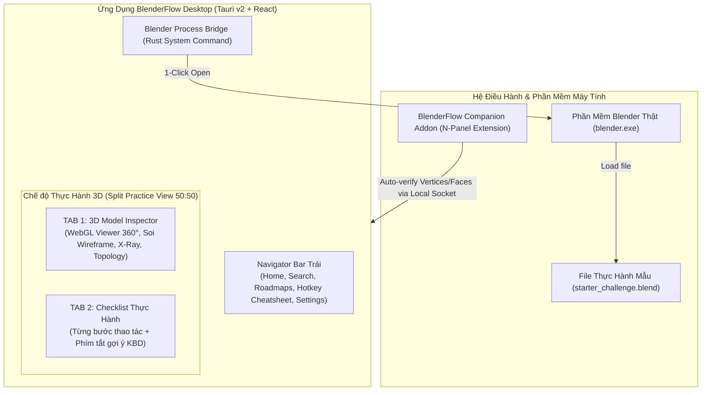
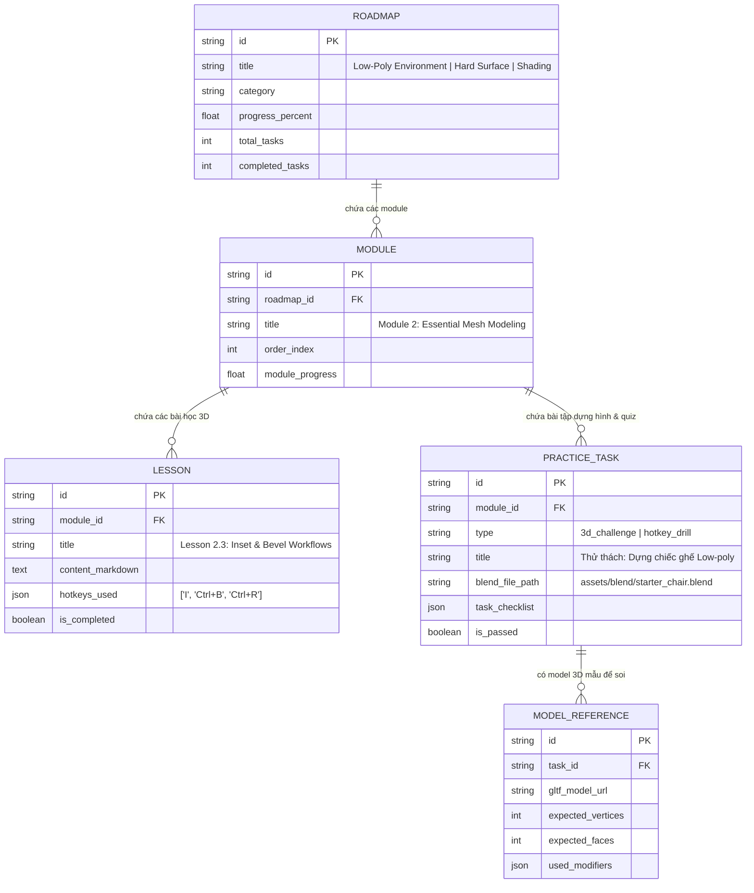
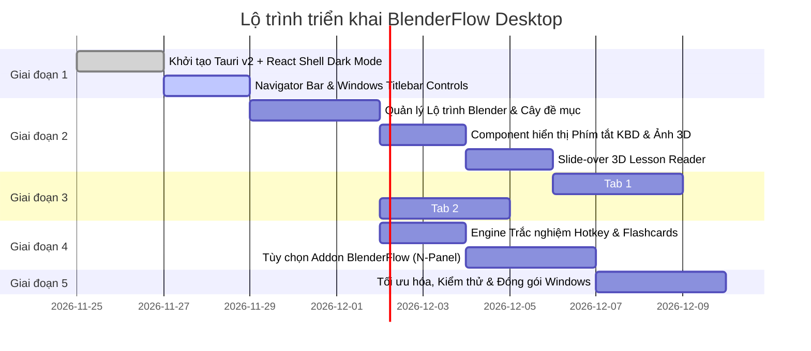

# KẾ HOẠCH CHI TIẾT & LỘ TRÌNH PHÁT TRIỂN PHẦN MỀM
## Ứng Dụng Desktop: Quản Lý Lộ Trình Học 3D Blender, Soi Mẫu Tương Tác & Luyện Tập Thực Hành (BlenderFlow Desktop)

---

## 1. TỔNG QUAN DỰ ÁN (PROJECT OVERVIEW)

### 1.1. Mục tiêu sản phẩm
Xây dựng một ứng dụng Desktop chuyên biệt hỗ trợ người học chinh phục phần mềm 3D **Blender**:
- **Lộ trình học 3D phân cấp rõ ràng**: Từ làm quen giao diện/Viewport $\rightarrow$ Mesh Modeling $\rightarrow$ Modifiers $\rightarrow$ Shading/Materials $\rightarrow$ Lighting & Rendering $\rightarrow$ Geometry Nodes/Sculpting.
- **Tính năng Độc quyền: Chế độ Thực Hành Chia Đôi Màn Hình (Dual-View Practice Mode 50:50)**:
  - **Tab 1: 3D Model Inspector (Mẫu Tham Chiếu Trực Quan 360°)**: Trình xem 3D tương tác siêu nhẹ tích hợp ngay trong app (WebGL/Three.js), cho phép người học xoay 360°, phóng to/thu nhỏ, bật chế độ **Wireframe** để soi kỹ cấu trúc đường lưới (Topology/Edge Flow), chế độ **Solid**, **X-Ray**, và xem thông số tham chiếu (Vertices, Faces, danh sách Modifiers).
  - **Tab 2: Live Blender Practice (Thực Hành Trực Tiếp Trên Blender Thật)**: Khởi động file bài tập `.blend` trên phần mềm Blender của máy tính. Đi kèm bảng **Checklist từng bước** và tùy chọn **Addon BlenderFlow (N-Panel)** hỗ trợ kiểm tra thông số lưới đối chiếu tự động.
- **Hệ thống Phím Tắt Trực Quan (Interactive Hotkey Badges `<kbd>`)**: Phím tắt là linh hồn của Blender. Hiển thị trực quan các tổ hợp phím bấm (`G`, `R`, `S`, `Tab`, `Ctrl + B`, `Shift + A`, `NumPad`).
- **Tích hợp AI Trợ Lý 3D (3D AI Tutor)**: Giải thích lỗi lật mặt lưới (Flipped Normals), lỗi non-manifold geometry, gợi ý topology chuẩn và tối ưu hóa file render.

### 1.2. Triết lý thiết kế cốt lõi
1. **Local-First & Không Giới Hạn Công Cụ**: Thực hành trên chính ứng dụng Blender native của máy tính để người dùng sở hữu 100% phím tắt, add-on và hiệu năng phần cứng GPU thật mà không bị giới hạn bởi nền tảng web.
2. **Soi Mẫu Đối Chiếu Tức Thì**: Không bắt người học phải chuyển qua chuyển lại giữa các cửa sổ; màn hình 50:50 vừa soi lưới mẫu xoay 360 độ vừa thao tác dựng hình trên Blender.
3. **Siêu nhẹ & Tiết kiệm RAM**: Ứng dụng xây dựng trên nền **Tauri v2 + React** (ngốn <25MB RAM), đảm bảo khi chạy song song với Blender thì máy tính vẫn hoạt động cực kỳ mượt mà.

---

## 2. KIẾN TRÚC HỆ THỐNG & CƠ CHẾ KẾT NỐI BLENDER

### 2.1. Chi tiết cơ chế hoạt động
1. **Tab 1: 3D Model Inspector (Bên Trái)**:
   - Dựng bằng Three.js / WebGL siêu nhẹ tích hợp trong React.
   - Nhận file mô hình chuẩn (glTF / OBJ) được đóng gói sẵn trong bài học.
   - Bộ công cụ tương tác:
     - 🔄 Xoay Orbit 360°, Pan, Zoom.
     - 🌐 Nút bật/tắt **Wireframe** (hiển thị rõ từng đường cạnh, mặt tứ giác quads).
     - 🔍 Nút bật/tắt **X-Ray** (xuyên thấu).
     - 📊 Thước đo thông số mẫu: `Vertices: 342`, `Faces: 320`, `Modifiers: Mirror + Bevel`.
2. **Tab 2: Live Blender Practice (Bên Phải)**:
   - Nút lớn: **"🚀 Mở Bài Tập Trong Blender"** $\rightarrow$ Tauri gọi lệnh native khởi chạy `blender.exe exercise.blend`.
   - Bảng nhiệm vụ (Task Checklist):
     - [ ] Bước 1: Tạo khối Cube (`Shift + A`).
     - [ ] Bước 2: Bo cạnh bằng Bevel (`Ctrl + B`).
     - [ ] Bước 3: Thêm vòng cắt Loop Cut (`Ctrl + R`).
   - Tùy chọn xác minh (Verification):
     - *Thủ công*: Tự tích hoàn thành sau khi đối chiếu với model mẫu.
     - *Tự động (Addon)*: Bấm nút "Check Topology" trên N-Panel của Blender, addon sẽ đếm số đỉnh/mặt đối chiếu và báo hoàn thành về ứng dụng.

---

## 3. CẤU TRÚC DỮ LIỆU CỐT LÕI (DATA SCHEMA)

---

## 4. QUY TRÌNH HOẠT ĐỘNG CHÍNH (KEY WORKFLOWS)

### 4.1. Luồng Học Lý Thuyết & Xem Minh Họa (Lesson Workspace)
1. Người dùng chọn một bài học từ Cây đề mục $\rightarrow$ Khung đọc bài trượt ra chiếm 80% màn hình.
2. Tiêu đề hiển thị dải phím tắt nổi bật (`<kbd>Tab</kbd>`, `<kbd>I</kbd>`, `<kbd>Ctrl+B</kbd>`).
3. Nội dung trình bày trực quan: Các bước thao tác 1-2-3, ảnh GIF minh họa tool, bảng so sánh và khung ghi chú cá nhân.
4. Bấm "Hoàn thành lý thuyết $\rightarrow$ Chuyển sang thực hành".

### 4.2. Luồng Thực Hành 3D Chia Đôi Màn Hình (Split Practice Flow)
1. Người dùng bấm **"Bắt đầu thực hành 3D"**:
   - Ứng dụng tự động điều chỉnh cửa sổ (Auto-Snap 50:50) hoặc chia không gian màn hình:
     - **Bên Trái**: Mở **Tab 1: 3D Inspector**. Model mẫu hiện lên, người dùng dùng chuột xoay 360 độ, bật chế độ Wireframe để soi từng đường cắt lưới (Edge loops). Phía dưới là bảng Checklist nhiệm vụ.
     - **Bên Phải**: Bấm nút "Mở Blender" $\rightarrow$ Ứng dụng tự động mở phần mềm Blender thật với file bài tập `starter_chair.blend`.
2. Người dùng vừa nhìn mẫu 3D xoay bên trái $\rightarrow$ Vừa dùng phím tắt native dựng hình trên Blender bên phải.
3. Khi hoàn thành:
   - Người dùng đối chiếu hình dạng và số đỉnh/mặt.
   - Bấm nút "Đánh dấu hoàn thành" trên App (hoặc bấm "Verify Topology" trên Addon Blender) $\rightarrow$ Thanh tiến độ khóa học tự động tăng % ngay lập tức.

### 4.3. Luồng Luyện Phản Xạ Phím Tắt (Hotkey Speed Drill)
1. Dưới mỗi Module có khối luyện phản xạ phím tắt.
2. Hiển thị câu hỏi tình huống: *"Phím tắt để bo tròn đỉnh (Vertex Bevel) thay vì bo cạnh trong Edit Mode là gì?"*.
3. Bấm chọn đáp án $\rightarrow$ Phản hồi Đúng (xanh)/Sai (đỏ) kèm khung mẹo nhớ phím tắt.

---

## 5. LỘ TRÌNH THỰC HIỆN THEO TỪNG GIAI ĐOẠN (IMPLEMENTATION ROADMAP)

