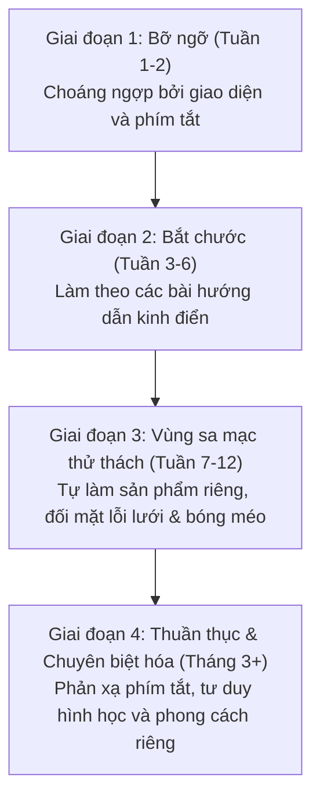

# 🚀 LỘ TRÌNH TOÀN DIỆN: TỪ SỐ 0 ĐẾN 3D ARTIST CHUYÊN NGHIỆP TRONG BLENDER

---

## 1. 4 GIAI ĐOẠN TÂM LÝ & BẪY HỌC TẬP CẦN VƯỢT QUA

### ⚠️ Các cạm bẫy lớn nhất của người tự học (Tutorial Hell)
1. **Bẫy xem thụ động**: Xem hàng chục video YouTube nhưng không trực tiếp mở Blender lên dựng lại. *Cách khắc phục: Tỷ lệ 30% Xem - 70% Thực hành.*
2. **Quên áp dụng Scale (Ctrl + A)**: Đây là nguyên nhân số 1 khiến Bevel méo, Texture bị kéo giãn và Physic rơi lệch.
3. **Lạm dụng Subdivision Surface**: Thêm modifier làm mịn bề mặt lên một lưới có N-gons hoặc tam giác không kiểm soát, dẫn đến lỗi nhăn nhúm (Pinching).
4. **Không dùng ảnh tham chiếu (Reference)**: Dựng hình hoàn toàn bằng trí nhớ mà không có ảnh góc nhìn Orthographic phía trước/bên hông.

---

## 2. KẾ HOẠCH HỌC TẬP 24 TUẦN THEO TỪNG CỘT MỐC

### 📌 THÁNG 1: NỀN TẢNG THAO TÁC & MODELING CƠ BẢN (Tuần 1 – Tuần 4)
- **Mục tiêu**: Không còn cảm giác "lạc lõng" trong không gian 3 chiều; nắm vững các thao tác biến đổi hình học cơ bản.
- **Tuần 1: Không gian 3D & Điều hướng Viewport**
  - Trục tọa độ (X: Đỏ, Y: Xanh lá, Z: Xanh dương).
  - Thao tác chuột giữa (MMB: Xoay, Shift + MMB: Lia màn hình, Cuộn: Phóng to thu nhỏ).
  - Các góc nhìn Numpad: `1` (Front), `3` (Right), `7` (Top), `9` (Opposite), `5` (Perspective / Orthographic).
  - Vòng chuyển Shading `Z`: Wireframe, Solid, Material Preview, Rendered.
- **Tuần 2: Thao tác biến đổi & 3D Cursor**
  - Bộ 3 phím vàng: `G` (Grab/Move), `R` (Rotate), `S` (Scale).
  - Khóa trục: Bấm `X`, `Y` hoặc `Z` sau khi bấm phím biến đổi; bấm `Shift + Z` để khóa di chuyển trên mặt phẳng X-Y.
  - Sức mạnh của 3D Cursor: `Shift + S` (Snap menu: Đưa tâm đối tượng về tâm không gian, hoặc bắt dính theo đỉnh chọn).
- **Tuần 3: Chế độ Edit Mode & Bộ công cụ đùn khối**
  - Chuyển chế độ: Phím `Tab`. Lựa chọn: `1` (Vertex), `2` (Edge), `3` (Face).
  - Đùn mặt: Phím `E` (Extrude).
  - Lõm mặt: Phím `I` (Inset Faces).
  - Cắt vòng lặp: Phím `Ctrl + R` (Loop Cut).
  - Vát cạnh: Phím `Ctrl + B` (Bevel).
- **Tuần 4: Dự án đầu tay (Milestone Project 1)**
  - *Đề bài:* Dựng một căn phòng Isometric Low-Poly gồm bàn học, ghế ngồi, máy tính, đèn bàn và kệ sách.

---

### 📌 THÁNG 2: HARD-SURFACE MODELING & MODIFIERS CHUYÊN SÂU (Tuần 5 – Tuần 8)
- **Mục tiêu**: Làm chủ quy trình dựng hình phi phá hủy (Non-destructive modeling), nắm chắc luật đi cạnh Quads.
- **Tuần 5: Nguyên lý Topology chuẩn công nghiệp**
  - Quads (Mặt 4 đỉnh) vs Triangles (Mặt 3 đỉnh) vs N-gons (Mặt >4 đỉnh).
  - Luồng cạnh (Edge Flow) và điểm tụ (Poles: N-pole 3 cạnh, E-pole 5 cạnh).
  - Khắc phục hình rách (Non-manifold geometry) và khử trùng điểm (`M` -> *By Distance*).
- **Tuần 6: Sức mạnh của Modifiers**
  - Nhóm tạo hình: *Subdivision Surface*, *Bevel*, *Solidify*.
  - Nhóm nhân bản: *Mirror* (Gương đối xứng có Clipping), *Array* (Dãy mảng), *Curve*.
  - Nhóm cắt khối: *Boolean Modifier* (Thuật toán Fast vs Exact).
- **Tuần 7: Hard-Surface chuyên nghiệp**
  - Kỹ thuật Bevel Weight và Crease.
  - Xử lý bóng méo bề mặt cong sau Boolean bằng *Weighted Normal Modifier* + *Harden Normals*.
- **Tuần 8: Dự án tháng 2 (Milestone Project 2)**
  - *Đề bài:* Dựng một hòm vũ khí viễn tưởng (Sci-Fi Military Crate) hoặc một khẩu súng máy Sci-Fi chi tiết, hoàn toàn bằng Quad topology.

---

### 📌 THÁNG 3: TRẢI UV, VẬT LIỆU PBR & PROCEDURAL SHADING (Tuần 9 – Tuần 12)
- **Mục tiêu**: Thổi hồn cho khối 3D thô xơ bằng bề mặt kim loại, gỗ, kính, da và hiệu ứng phong hóa.
- **Tuần 9: Bản chất của UV Unwrapping**
  - Tư duy "cắt may quần áo": Đường rạch (Mark Seam - `Ctrl + E`).
  - Mở trải lưới (`U` -> *Unwrap*).
  - Sắp xếp đảo UV (`Pack Islands`) và khái niệm Mật độ điểm ảnh (Texel Density).
- **Tuần 10: Nguyên lý vật lý PBR & Principled BSDF**
  - Base Color (Màu nền albedo).
  - Roughness (Độ nhám / Phản chiếu).
  - Metallic (Đặc tính dẫn điện / Kim loại: Luôn là 0 hoặc 1, không đặt lơ lửng 0.5).
  - Normal Map & Bump Map (Đánh lừa thị giác tạo độ lồi lõm chi tiết nhỏ mà không tốn đa giác).
  - Transmission (Độ truyền quang / Thủy tinh) & IOR (Chiết suất khúc xạ).
- **Tuần 11: Làm chủ Shader Editor & Node Wrangler**
  - Kích hoạt addon miễn phí có sẵn *Node Wrangler* (`Ctrl + T` nạp bộ texture PBR 1 giây, `Ctrl + Shift + Click` soi thử node).
  - Các node thủ tục: *Noise Texture*, *Voronoi Texture*, *ColorRamp*, *Mapping*, *Texture Coordinate*.
- **Tuần 12: Dự án tháng 3 (Milestone Project 3)**
  - *Đề bài:* Trải UV và tô vật liệu cho chiếc rương báu cổ phong hóa gồm gỗ mủn xước, đai sắt rỉ sét và ngọc phát quang.

---

### 📌 THÁNG 4: ÁNH SÁNG STUDIO, RENDER & HẬU KỲ (Tuần 13 – Tuần 16)
- **Mục tiêu**: Tạo ra bức ảnh 3D đẹp mắt, có chiều sâu, tương phản giàu cảm xúc như chụp tại studio chuyên nghiệp.
- **Tuần 13: Lý thuyết chiếu sáng điện ảnh**
  - Thiết lập 3 nguồn sáng kinh điển: *Key Light* (Đèn chính), *Fill Light* (Đèn phụ bù bóng), *Rim/Back Light* (Đèn ven tách viền chủ thể).
  - Nhiệt độ màu (Kelvin: Ấm 3200K vs Lạnh 6500K) và tỷ lệ tương phản.
  - Sử dụng ánh sáng môi trường thực tế (HDRI) từ Poly Haven.
- **Tuần 14: So sánh 2 cỗ máy Render (Cycles vs EEVEE Next)**
  - *Cycles*: Ray-tracing tính toán đường đi photon chân thực, khử nhiễu AI (OptiX / OpenImageDenoise).
  - *EEVEE Next*: Render thời gian thực tốc độ cao trên nền Vulkan, Screen Space Reflections, Ray-traced Shadows.
  - Tính năng *Light Linking* (Chỉ định đèn chỉ chiếu vào đối tượng nhất định).
- **Tuần 15: Camera & Bố cục thị giác**
  - Tiêu cự ống kính (Focal Length: 24mm góc rộng, 50mm mắt người, 85mm chân dung/sản phẩm).
  - Độ sâu trường ảnh (Depth of Field - xóa phông mờ nghệ thuật).
  - Bố cục 1/3, đường dẫn (Leading lines), khung lồng khung (Framing).
- **Tuần 16: Hậu kỳ với Compositor**
  - Tách các lớp Render Passes: Mist Pass (tạo sương mù chiều sâu), Cryptomatte (tách đối tượng).
  - Hiệu ứng Glare / Bloom (Ánh sáng lóe), Color Balance (Chỉnh tông màu điện ảnh).

---

### 📌 THÁNG 5: ĐIÊU KHẮC HỮU CƠ (SCULPTING) & TẠO XƯƠNG (RIGGING) (Tuần 17 – Tuần 20)
- **Tuần 17: Chế độ Sculpt Mode**
  - Bộ cọ chính: *Clay Strips*, *Grab*, *Snake Hook*, *Crease*, *Smooth*, *Inflate*.
  - *Dyntopo* (Tự động thêm lưới khi kéo dãn) vs *Voxel Remesh* (Tái tạo khối đồng nhất).
- **Tuần 18: Retopology (Làm lại lưới nhẹ)**
  - Kỹ thuật dùng cọ *PolyBuild* và *Shrinkwrap Modifier* để bọc lưới quads nhẹ chuẩn chuyển động lên tượng điêu khắc triệu đỉnh.
- **Tuần 19: Hệ thống xương Armatures**
  - Cấu trúc xương cha con (Parenting hierarchy).
  - Gắn xương tự động (*Parent with Automatic Weights*) và sơn trọng số (*Weight Painting*).
- **Tuần 20: Động học ngược (Inverse Kinematics - IK)**
  - Ràng buộc xương IK cho chân và tay (di chuyển bàn chân thì đầu gối và đùi tự co tự nhiên).

---

### 📌 THÁNG 6: HOẠT HỌA (ANIMATION), GEOMETRY NODES & TỐI ƯU GAME (Tuần 21 – Tuần 24)
- **Tuần 21: 12 Nguyên tắc hoạt họa & Graph Editor**
  - Keyframing trên Timeline và Dope Sheet.
  - Điều chỉnh đường cong chuyển động Bezier trên Graph Editor (Gia tốc vào ra - Ease In/Ease Out).
- **Tuần 22: Nhập môn Geometry Nodes**
  - Kiến trúc node thủ tục (Procedural modeling).
  - Tán rải ngẫu nhiên cỏ cây, sỏi đá trên bề mặt đồi núi bằng *Distribute Points on Faces* và *Instance on Points*.
- **Tuần 23: Mô phỏng vật lý (Physics & Simulation)**
  - Rigid Body (Vật thể rắn va chạm sụp đổ).
  - Cloth Simulation (Vải cờ bay, khăn trải bàn).
- **Tuần 24: Tối ưu Game Pipeline & Đồ án tốt nghiệp**
  - Nướng chi tiết (Bake Normal Map & Ambient Occlusion từ tượng High-poly sang mesh Low-poly).
  - Xuất file định dạng chuẩn quốc tế `.fbx` và `.gltf` đưa vào Unreal Engine 5 hoặc Unity.
