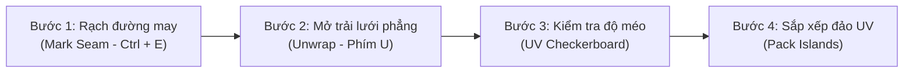

# 🗺️ BÀI 4.1: NGUYÊN LÝ TRẢI LƯỚI UV UNWRAPPING CHUẨN XÁC

---

## 1. UV UNWRAPPING LÀ GÌ?

Hãy tưởng tượng bạn có một chiếc hộp quà hình lập phương bằng bìa carton:
- Muốn in họa tiết hoa văn phẳng từ máy in 2D lên các mặt của chiếc hộp, bạn phải lấy kéo rạch các cạnh và **trải phẳng chiếc hộp ra một mặt phẳng 2 chiều**.
- Trục tọa độ 3D là $X, Y, Z$. Trục tọa độ 2D của bức ảnh hoa văn được gọi là **$U$ và $V$** (chữ cái đứng trước $X, Y, Z$ trong bảng chữ cái). Quá trình trải lưới này được gọi là **UV Unwrapping**.

---

## 2. QUY TRÌNH TRẢI UV 4 BƯỚC CHUẨN CÔNG NGHIỆP

### Bước 1: Rạch đường may (Mark Seam)
- Vào Edit Mode, chuyển sang chọn cạnh (`2`).
- Chọn những cạnh nằm ở góc khuất thị giác (mặt dưới đáy, mặt trong cánh tay, phía sau gáy).
- Nhấn tổ hợp phím **`Ctrl + E`** $\rightarrow$ chọn **`Mark Seam`** (Cạnh sẽ chuyển sang viền màu đỏ tươi rực).

### Bước 2: Mở trải phẳng (Unwrap)
- Bấm phím **`A`** để chọn toàn bộ lưới.
- Bấm phím **`U`** $\rightarrow$ chọn **`Unwrap`**. Mở tab *UV Editing* bạn sẽ thấy các mảng lưới phẳng (gọi là **UV Islands**) nằm gọn gàng trong ô vuông tọa độ $(0, 0)$ đến $(1, 1)$.

### Bước 3: Kiểm tra độ méo bằng UV Checker
- Gán một bức ảnh caro ô vuông (UV Checker Grid) lên vật thể.
- Nếu các ô vuông trên vật thể bị méo thành hình bình hành hoặc hình thang, nghĩa là vết rạch Seam chưa đủ để giải phóng sức căng của bề mặt $\rightarrow$ Cần rạch thêm đường Seam phụ.

### Bước 4: Sắp xếp đảo UV (Pack Islands)
- Trong cửa sổ UV Editor, bấm **`A`** chọn toàn bộ đảo UV.
- Vào menu **UV** $\rightarrow$ chọn **`Pack Islands`** (Phím tắt `Ctrl + P`).
- Đặt thông số **Margin** khoảng `0.01` đến `0.02` để các đảo UV cách nhau một khoảng an toàn (tránh tình trạng màu của đảo này bị lem sang đảo kia khi giảm độ phân giải texture).

---

## 3. KHÁI NIỆM MẬT ĐỘ ĐIỂM ẢNH (TEXEL DENSITY)

- **Texel Density** là tỷ lệ giữa kích thước điểm ảnh của texture (Pixels) so với kích thước thật của vật thể trong không gian 3D (Meters/Centimeters).
- **Quy tắc vàng:** Các bộ phận quan trọng cần rõ nét (ví dụ khuôn mặt, logo trước ngực) phải có diện tích đảo UV to hơn; các bộ phận khuất (đế giày, nội tạng bên trong) thu nhỏ đảo UV lại để tiết kiệm bộ nhớ VRAM của card đồ họa.
